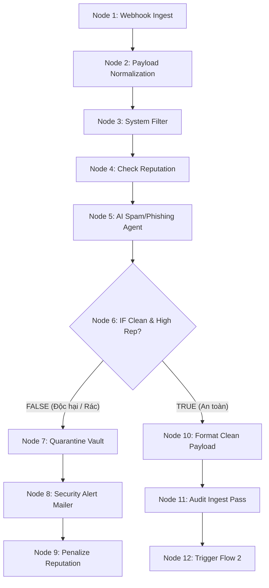
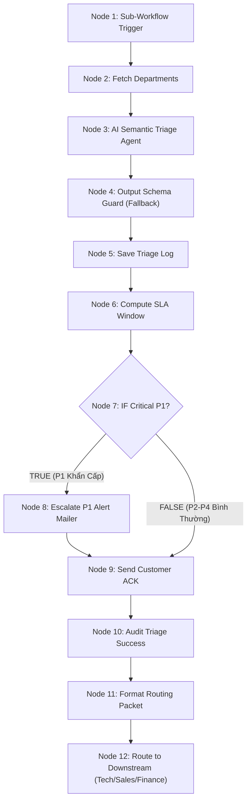
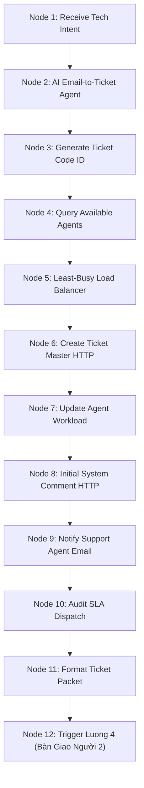

# TOÀN THƯ KỸ THUẬT & CẨM NANG BẢO VỆ ĐỒ ÁN TOÀN DIỆN
## DỰ ÁN: INTELLIGENT ENTERPRISE EMAIL AUTOMATION & HELPDESK CRM
### TRỌNG TÂM ĐẶC BIỆT: NHIỆM VỤ NGƯỜI 1 (LUỒNG 1, LUỒNG 2, LUỒNG 3)
**Môi trường:** Local Phòng Lab & Máy Chủ Cục Bộ (Docker Compose + n8n + PostgreSQL 16 pgvector)  
**Đơn vị:** Trường Đại học Công nghệ Thông tin & Truyền thông Việt - Hàn (VKU) - Đại học Đà Nẵng  
**Phiên bản:** Chuẩn hóa 100% theo mã nguồn, API và CSDL dự án hiện tại

---

## MỤC LỤC TỔNG QUAN
- [PHẦN 1: TỔNG QUAN HỆ THỐNG VÀ KIẾN TRÚC TOÀN DIỆN](#phần-1-tổng-quan-hệ-thống-và-kiến-trúc-toàn-diện)
  - [1.1. Bản chất dự án: Là gì? Làm gì? Mục đích gì?](#11-bản-chất-dự-án-là-gì-làm-gì-mục-đích-gì)
  - [1.2. Ngăn xếp công nghệ chuẩn hóa (Tech Stack)](#12-ngăn-xếp-công-nghệ-chuẩn-hóa-tech-stack)
  - [1.3. Hạ tầng Docker, Mạng và Tính toàn vẹn dữ liệu](#13-hạ-tầng-docker-mạng-và-tính-toàn-vẹn-dữ-liệu)
  - [1.4. Quy tắc chuẩn hóa: 3 Thành viên × 3 Luồng × Đúng 12 Nodes](#14-quy-tắc-chuẩn-hóa-3-thành-viên--3-luồng--đúng-12-nodes)
  - [1.5. Hệ sinh thái 10 AI Agents chuyên biệt](#15-hệ-sinh-thái-10-ai-agents-chuyên-biệt)
  - [1.6. Email Automation nằm ở đâu? 3 Hòm thư chuẩn hóa](#16-email-automation-nằm-ở-đâu-3-hòm-thư-chuẩn-hóa)
  - [1.7. Danh mục 14 Bảng CSDL PostgreSQL 16 & pgvector](#17-danh-mục-14-bảng-csdl-postgresql-16--pgvector)
- [PHẦN 2: CHUYÊN SÂU ĐẶC BIỆT: NHIỆM VỤ NGƯỜI 1 (LUỒNG 1, 2, 3)](#phần-2-chuyên-sâu-đặc-biệt-nhiệm-vụ-người-1-luồng-1-2-3)
  - [Bức tranh đời thực: Người 1 đóng vai trò gì?](#bức-tranh-đời-thực-người-1-đóng-vai-trò-gì)
  - [2.1. Luồng 1: Ingest, Anti-Spam & Blacklist Quarantine (12 Nodes)](#21-luồng-1-ingest-anti-spam--blacklist-quarantine-12-nodes)
  - [2.2. Luồng 2: AI Multi-Department Triage & SLA Acknowledgment (12 Nodes)](#22-luồng-2-ai-multi-department-triage--sla-acknowledgment-12-nodes)
  - [2.3. Luồng 3: AI Ticket Generation & Least-Busy SLA Dispatcher (12 Nodes)](#23-luồng-3-ai-ticket-generation--least-busy-sla-dispatcher-12-nodes)
- [PHẦN 3: TỔNG QUAN TÓM TẮT 6 LUỒNG CÒN LẠI (LUỒNG 4 ĐẾN 9)](#phần-3-tổng-quan-tóm-tắt-6-luồng-còn-lại-luồng-4-đến-9)
- [PHẦN 4: BỘ KỊCH BẢN KIỂM THỬ THỰC TẾ & LIÊN HOÀN E2E](#phần-4-bộ-kịch-bản-kiểm-thử-thực-tế--liên-hoàn-e2e)
- [PHẦN 5: TOÀN BỘ CÂU LỆNH VẬN HÀNH TRÊN MÁY THỰC TẾ](#phần-5-toàn-bộ-câu-lệnh-vận-hành-trên-máy-thực-tế)
- [PHẦN 6: BỘ CÂU HỎI VẤN ĐÁP HỘI ĐỒNG & CÁCH TRẢ LỜI ĐẠT ĐIỂM 10 TUYỆT ĐỐI (DÀNH CHO NGƯỜI 1)](#phần-6-bộ-câu-hỏi-vấn-đáp-hội-đồng--cách-trả-lời-đạt-điểm-10-tuyệt-đối-dành-cho-người-1)

---

# PHẦN 1: TỔNG QUAN HỆ THỐNG VÀ KIẾN TRÚC TOÀN DIỆN

### 1.1. Bản chất dự án: Là gì? Làm gì? Mục đích gì?
* **Tên dự án:** Intelligent Enterprise Email Automation & Helpdesk CRM (Hệ thống tự động hóa xử lý email doanh nghiệp và quản lý phiếu hỗ trợ thông minh đa tác tử).
* **Bài toán thực tế của doanh nghiệp:** Trong môi trường doanh nghiệp vừa và lớn, hòm thư tập trung (`contact@`, `support@`, `sales@`, `billing@`) tiếp nhận hàng nghìn thư mỗi ngày dẫn đến 5 điểm nghẽn nghiêm trọng:
  1. *Chậm trễ & Quá tải:* Nhân sự mất 4–8 tiếng mỗi ngày chỉ để đọc, phân loại thư rác và chuyển tiếp thủ công giữa các phòng ban.
  2. *Trễ cam kết chất lượng dịch vụ (SLA Breach):* Các sự cố thảm họa cấp P1 (Sập cơ sở dữ liệu, đứt cổng thanh toán) bị chìm lẫn trong hàng trăm email quảng cáo, dẫn đến xử lý muộn gây thiệt hại tài chính nặng nề.
  3. *Phản hồi thiếu nhất quán:* Kỹ thuật viên tự tra cứu tài liệu rời rạc hoặc tự trả lời theo trí nhớ, dẫn đến sai sót cam kết với khách hàng.
  4. *Bỏ lỡ khách hàng tiềm năng:* Email hỏi mua hàng không được bóc tách số điện thoại, ngân sách kịp thời và thiếu quy trình nuôi dưỡng tự động (Cadence Follow-up) sau 48 giờ.
  5. *Gian lận chứng từ kế toán:* Kế toán viên phải rà soát số học thủ công hàng trăm hóa đơn VAT mỗi tháng.
* **Mục tiêu của dự án:** Xây dựng một Hệ sinh thái Tự động hóa khép kín (End-to-End):
  - Tự động tiếp nhận email qua Webhook/Mail Server.
  - Dùng AI phát hiện và cách ly thư rác, lừa đảo (Anti-Spam & Phishing) vào Kho cách ly (`email_quarantine_vault`).
  - Dùng AI phân tích ngữ nghĩa, tự động phân loại về 4 phòng ban: Kỹ thuật (**TECH**), Kinh doanh (**SALES**), Tài chính (**FINANCE**), Hành chính (**GENERAL**).
  - Tự động tính hạn cam kết dịch vụ SLA và gửi thư xác nhận tức thì (ACK) cho khách hàng.
  - Tự động chuyển email kỹ thuật thành vé sự cố tiêu chuẩn (`TK-YYYYMMDD-XXXX`), áp dụng thuật toán cân bằng tải **Least-Busy** chia việc cho KTV rảnh nhất.
  - Dùng AI kết hợp tri thức nội bộ (Vector Search pgvector RAG) tự động soạn sẵn thư nháp kỹ thuật.
  - Cung cấp giao diện Web cho chuyên viên duyệt thư (**Human-in-the-Loop - HITL**) trước khi bấm gửi chính thức qua SMTP.
  - Quét hóa đơn tự động bằng Multimodal Vision AI, đối soát tính toàn vẹn số học ($\le 1$ VNĐ).
  - Tự động phát hành báo cáo điều hành tổng hợp 24H (Executive Digest) cho Ban Giám Đốc.

### 1.2. Ngăn xếp công nghệ chuẩn hóa (Tech Stack)
* **Workflow Automation Engine:** **n8n Official Docker (Cổng 5678)** đóng vai trò bộ não điều phối toàn bộ sự kiện theo đồ thị có hướng không chu trình (DAG - Directed Acyclic Graph).
* **Mô hình Trí tuệ Nhân tạo (AI & LLM):**
  - *Google Gemini 1.5/2.0 Flash:* Phân tích ngữ cảnh tiếng Việt, phân loại phòng ban, bóc tách thực thể vé/CRM, tóm tắt báo cáo điều hành.
  - *Google text-embedding-004:* Mã hóa tài liệu kỹ thuật thành vector nhúng 768 chiều.
  - *Gemini Multimodal Vision AI:* Đọc và bóc tách dữ liệu từ file ảnh/PDF hóa đơn VAT.
* **Cơ sở dữ liệu (Database):** **PostgreSQL 16 tích hợp extension pgvector (Cổng 5432)** quản lý 14 bảng quan hệ ACID, đồng thời lưu trữ và tìm kiếm vector tương đồng Cosine Similarity cho RAG.
* **Backend API Core:** **NestJS (Node.js/TypeScript chuẩn doanh nghiệp, Cổng 4000)** cung cấp RESTful API, quản trị vé, phòng ban, nhân sự, kiểm toán và phát WebSocket/SSE realtime.
* **Frontend:** **Next.js 14 App Router (React + TailwindCSS, Cổng 3000)** gồm Dashboard điều hành, quản trị vé, màn hình duyệt thư HITL, CRM Pipeline và Invoice Audit.
* **Hạ tầng đóng gói:** Docker & Docker Compose ảo hóa môi trường n8n và PostgreSQL, đảm bảo tính độc lập và khả năng phục hồi dữ liệu 100%.

### 1.3. Hạ tầng Docker, Mạng và Tính toàn vẹn dữ liệu
* **Mô hình phân bổ cổng mạng cục bộ:**
  - `5432`: PostgreSQL 16 + pgvector container (`enterprise_db`)
  - `5678`: n8n Workflow Automation container (`enterprise_n8n`)
  - `4000`: NestJS Core Backend API
  - `3000`: Next.js 14 SaaS Frontend UI
* **Cơ chế Webhook:** Node Webhook nằm bên trong container n8n. Khi n8n ánh xạ cổng `5678:5678` ra máy host, mọi HTTP POST request gửi tới `http://localhost:5678/webhook/...` đều được Docker chuyển tiếp ngay lập tức vào container n8n để kích hoạt workflow.
* **Tính toàn vẹn dữ liệu (Data Persistence):** Dự án cấu hình Named Docker Volumes chuyên dụng:
  - Volume `enterprise_postgres_data` ánh xạ vào `/var/lib/postgresql/data`.
  - Volume `enterprise_n8n_data` ánh xạ vào `/home/node/.n8n`.
  - Toàn bộ bảng dữ liệu, vector embeddings, lịch sử workflow và credentials được ghi trên ổ đĩa vật lý của máy chủ. Khi chạy `docker compose down` rồi bật lại, dữ liệu được phục hồi 100%.
* **Môi trường thực thi Javascript trong n8n:** Các Node Code Javascript được thực thi độc lập bởi Node.js runtime tích hợp sẵn bên trong container Docker n8n.

### 1.4. Quy tắc chuẩn hóa: 3 Thành viên × 3 Luồng × Đúng 12 Nodes
Toàn bộ dự án gồm 9 Micro-Workflows, mỗi workflow được thiết kế khắt khe đúng **12 bước xử lý DAG** (Tổng cộng: $9 \times 12 = 108$ Nodes):

| Phân hệ | Thành viên | Mã Luồng | Tên File JSON | Vai trò cốt lõi |
| :--- | :--- | :--- | :--- | :--- |
| **PHẦN 1** | **Thành viên 1 (Trọng tâm của bạn)** | **Luồng 1** | `flow01_ingest_antispam.json` | Cửa ngõ tiếp nhận, lọc spam, quét phishing, cách ly & trừ điểm uy tín. |
| | | **Luồng 2** | `flow02_department_triage.json` | Phân loại AI 4 phòng ban, bảo vệ schema guard, tính SLA, gửi thư xác nhận & rẽ nhánh. |
| | | **Luồng 3** | `flow03_ticket_sla_dispatch.json` | Bóc tách sự cố, tạo vé `TK-XXXX`, cân bằng tải Least-Busy cho KTV. |
| **PHẦN 2** | Thành viên 2 | Luồng 4 | `flow04_rag_knowledge_draft.json` | Vector Search pgvector (768 dim), Gemini viết thư nháp kỹ thuật. |
| | | Luồng 5 | `flow05_hitl_approval_send.json` | Giao diện duyệt thư Human-in-the-Loop, gửi SMTP chính thức, đóng vé. |
| | | Luồng 6 | `flow06_executive_digest.json` | Báo cáo điều hành 24h cho BGĐ và cảnh báo đột biến sự cố P1 (>20%). |
| **PHẦN 3** | Thành viên 3 | Luồng 7 | `flow07_crm_lead_scoring.json` | Bóc tách khách hàng tiềm năng, tính Lead Score (0–100), tạo Deal CRM. |
| | | Luồng 8 | `flow08_automated_followup.json` | Tự động gửi email nuôi dưỡng sau báo giá quá 48h (3 chặng). |
| | | Luồng 9 | `flow09_invoice_multimodal_ocr.json` | AI thị giác đọc hóa đơn VAT, kiểm toán số học $\le 1$ đ, báo cáo Kế toán trưởng. |

### 1.5. Hệ sinh thái 10 AI Agents chuyên biệt
1. **Agent 1 - AI Email Triage Agent (Luồng 2 - Node 3):** Phân tích ngữ cảnh tiếng Việt, định tuyến 4 phòng ban (TECH, SALES, FINANCE, GENERAL), gán mức ưu tiên P1–P4, xác định sắc thái cảm xúc.
2. **Agent 2 - AI Email Reply Agent (Luồng 4 - Node 6 & Luồng 5):** Kết hợp ngữ cảnh tri thức nội bộ từ pgvector để soạn thư trả lời kỹ thuật chuẩn xác, HTML chuyên nghiệp.
3. **Agent 3 - AI Email-to-Ticket Agent (Luồng 3 - Node 2):** Bóc tách tiêu đề chuẩn, phân hệ lỗi (`affected_module`), triệu chứng lỗi và các bước tái hiện (`reproduce_steps`).
4. **Agent 4 - AI Email-to-CRM Agent (Luồng 7 - Node 2):** Bóc tách thực thể kinh doanh (Tên, SĐT +84, Tên công ty, Nhu cầu, Ngân sách dự kiến).
5. **Agent 5 - AI Email Summarization Agent (Luồng 6 - Node 5):** Đọc toàn bộ dữ liệu 24h, phân tích sắc thái chung và chỉ ra đúng 3 điểm nghẽn nghiêm trọng nhất cho Ban Giám Đốc.
6. **Agent 6 - AI Email Follow-up Agent (Luồng 8 - Node 6):** Đọc ngữ cảnh deal trễ > 48h, tạo email chăm sóc cá nhân hóa theo 3 giai đoạn.
7. **Agent 7 - AI Campaign Agent (Luồng 7 - Node 3):** Định vị phân khúc khách hàng (ENTERPRISE_HIGH_VALUE vs SME_RETAIL) để gán nhãn chiến dịch bán hàng.
8. **Agent 8 - AI Deliverability & Anomaly Monitor (Luồng 1 - Node 4 & Luồng 6 - Node 4):** Kiểm soát điểm tín nhiệm người gửi (`reputation_score`) và phát hiện dị thường khi số lỗi P1 tăng đột biến > 20%.
9. **Agent 9 - AI Spam & Phishing Classification Agent (Luồng 1 - Node 5):** Quét mã độc, thư rác, hành vi lừa đảo tài chính qua prompt bảo mật cấu trúc JSON.
10. **Agent 10 - AI Multimodal Attachment Processing Agent (Luồng 9 - Node 4):** Nhận diện thị giác file PDF/ảnh hóa đơn, bóc tách Số HĐ, Mã số thuế, Tiền hàng, VAT và Tổng tiền.

### 1.6. Email Automation nằm ở đâu? 3 Hòm thư chuẩn hóa
* **3 Hòm thư tiêu chuẩn:**
  1. `kieutrangg06123@gmail.com`: **SMTP System Sender (Robot phát tán)** – Cấu hình Google App Password trên n8n để gửi email tự động.
  2. `tranngo170770@gmail.com`: **Internal Admin / Support Staff (Nội bộ công ty)** – Hòm thư tiếp nhận của Quản trị viên SOC, Kỹ thuật viên trực nhật, Nhân viên Sales, Kế toán trưởng, Ban Giám Đốc.
  3. `trangltk.24it@vku.udn.vn`: **Client / External Sender (Khách hàng bên ngoài)** – Đóng vai khách hàng gửi yêu cầu và nhận phản hồi.
* **Các điểm Gửi và Nhận Mail cụ thể:**
  - *Điểm Inbound:* Khách hàng gửi email $\rightarrow$ Webhook tiếp nhận tại `/webhook/m1-flow1-ingest`.
  - *Điểm Outbound 1 (Luồng 1 - Node 8):* Gửi cảnh báo an ninh SOC tới Quản trị viên (`tranngo170770@gmail.com`) khi phát hiện thư rác/lừa đảo.
  - *Điểm Outbound 2 (Luồng 2 - Node 8):* Gửi báo động khẩn cấp P1 tới KTV trực nhật (`tranngo170770@gmail.com`) khi hệ thống gặp sự cố tê liệt.
  - *Điểm Outbound 3 (Luồng 2 - Node 9):* Gửi email xác nhận (ACK) kèm mã tra cứu (`REQ-XXXX`) và cam kết thời gian SLA tới khách hàng (`trangltk.24it@vku.udn.vn`).
  - *Điểm Outbound 4 (Luồng 3 - Node 9):* Gửi email thông báo phân công vé cho KTV phụ trách (`tranngo170770@gmail.com`).
  - *Điểm Outbound 5 (Luồng 5 - Node 5):* Gửi email trả lời kỹ thuật chính thức sau khi chuyên viên bấm duyệt trên Web tới khách hàng (`trangltk.24it@vku.udn.vn`).
  - *Điểm Outbound 6 (Luồng 6, 7, 8, 9):* Gửi báo cáo ngày cho Giám đốc, thông báo Lead cho Sales, chuỗi nuôi dưỡng Follow-up cho khách, và thông báo đối soát cho Kế toán trưởng.

### 1.7. Danh mục 14 Bảng Cơ sở dữ liệu PostgreSQL 16 & pgvector
| STT | Tên Bảng | Thuộc phân hệ | Chức năng chi tiết |
| :---: | :--- | :---: | :--- |
| 1 | `departments` | Core | Danh mục 4 phòng ban: TECH, SALES, FINANCE, GENERAL. |
| 2 | `email_senders_reputation` | **TV1** | Điểm tín nhiệm người gửi (0–100), số lần vi phạm (`failed_attempts`), cờ `is_blocked`. |
| 3 | `email_quarantine_vault` | **TV1** | Kho lưu trữ cách ly các email rác, lừa đảo hoặc email hệ thống rác để kiểm toán. |
| 4 | `email_triage_logs` | **TV1** | Nhật ký phân loại AI: phòng ban, mức ưu tiên P1–P4, sắc thái, độ tin cậy, hạn SLA. |
| 5 | `support_agents` | **TV1** | Danh sách KTV kỹ thuật, trạng thái trực và bộ đếm vé đang xử lý (`active_tickets_count`). |
| 6 | `tickets` | **TV1** | Bảng vé sự cố trung tâm (`TK-YYYYMMDD-XXXX`, mức độ, KTV phụ trách, trạng thái PENDING/RESOLVED). |
| 7 | `ticket_comments` | **TV1** | Lịch sử trao đổi trên vé, lưu phân tích bóc tách ban đầu của AI và phản hồi của KTV. |
| 8 | `knowledge_base` | TV2 | Kho cẩm nang kỹ thuật lưu vector nhúng 768 chiều (`embedding vector(768)`). |
| 9 | `email_drafts` | TV2 | Lưu các thư nháp do AI RAG tạo ra ở trạng thái PENDING_APPROVAL chờ duyệt HITL. |
| 10 | `daily_summaries` | TV2 | Lưu báo cáo tóm tắt vận hành ngày gửi cho Ban Giám Đốc. |
| 11 | `daily_digest_recipients`| TV2 | Danh sách email Ban Giám Đốc nhận báo cáo định kỳ. |
| 12 | `crm_customers` | TV3 | Danh bạ khách hàng tiềm năng, SĐT, công ty và điểm tiềm năng (`lead_score`). |
| 13 | `crm_deals` | TV3 | Các cơ hội kinh doanh (NEW_INQUIRY, QUOTED, COLD_LEAD, WON, LOST). |
| 14 | `finance_invoices` | TV3 | Lưu trữ chứng từ hóa đơn và trạng thái đối soát (VALIDATED vs DISCREPANCY_FLAGGED). |
| * | `system_audit_logs` | Global | Bảng nhật ký kiểm toán toàn cục ghi vết mọi sự kiện trọng yếu từ Luồng 1 đến Luồng 9. |

---

# PHẦN 2: CHUYÊN SÂU ĐẶC BIỆT: NHIỆM VỤ NGƯỜI 1 (LUỒNG 1, 2, 3)

### Bức tranh đời thực: Người 1 đóng vai trò gì?
Công ty bạn mở một hòm thư tiếp nhận email của khách hàng. Bạn chịu trách nhiệm quản lý **3 trạm gác đầu tiên**:
* **Luồng 1 (Bác bảo vệ & Máy soi an ninh):** Kiểm tra xem thư gửi đến là thư sạch hay thư rác/lừa đảo/virus. Thư bẩn thì nhốt vào "phòng cách ly" và phạt điểm người gửi. Thư sạch thì đóng dấu cho qua.
* **Luồng 2 (Cô lễ tân thông minh):** Đọc nội dung thư sạch xem khách muốn gì, thuộc phòng ban nào (Kỹ thuật, Bán hàng hay Kế toán?), hẹn khách mấy giờ sẽ trả lời (SLA), gửi email báo cho khách yên tâm, rồi chuyển hồ sơ đến đúng phòng ban.
* **Luồng 3 (Đội trưởng kỹ thuật phân công việc):** Nếu thư gửi đến phòng Kỹ thuật (báo lỗi, sập mạng), đội trưởng sẽ bóc tách chi tiết lỗi, xem trong đội ai đang rảnh nhất thì giao việc, tạo "Vé sự cố" (Ticket) trên hệ thống, gửi email hối KTV làm việc, rồi bàn giao hồ sơ sang cho Người 2 (Luồng 4 RAG).

---

### 2.1. LUỒNG 1: EMAIL INGEST, ANTI-SPAM & BLACKLIST QUARANTINE
* **Tệp cấu hình:** [`workflows/flow01_ingest_antispam.json`](file:///home/kieu-trang/email-automation/workflows/flow01_ingest_antispam.json) (Workflow ID: `96BvBRGhR7jcUjTf`)
* **Vai trò:** Cửa ngõ phòng vệ đầu tiên, làm sạch dữ liệu, kiểm tra danh tính người gửi, phát hiện Spam/Phishing bằng Gemini, cách ly thư bẩn, phạt điểm uy tín và chuyển tiếp thư sạch.
* **AI Agents tích hợp:** **Agent 9** (AI Classification & Phishing Detector) và **Agent 8** (Deliverability & Reputation Monitor).
* **Bảng CSDL tương tác:** `email_senders_reputation`, `email_quarantine_vault`, `system_audit_logs`.



#### Phân tích chi tiết từng Node từ 1 đến 12 của Luồng 1:
1. **Node 1: Webhook Ingest Trigger (`n8n-nodes-base.webhook`):**
   - *Cấu hình:* `httpMethod: POST`, `path: m1-flow1-ingest`, `responseMode: onReceived`, `responseData: OK`.
   - *Nhiệm vụ:* Đón nhận HTTP POST payload từ mail server hoặc client test. Trả ngay mã 200 OK để không làm nghẽn tiến trình bên ngoài.
2. **Node 2: Payload Normalization (`n8n-nodes-base.code`):**
   - *Nhiệm vụ:* Chuẩn hóa dữ liệu thô:
     - Trích xuất địa chỉ email thuần túy bằng Regex xóa dấu ngoặc nhọn: `String(rawSender).match(/<([^>]+)>/)`.
     - Tách tên người gửi hiển thị (`sender_name`).
     - Làm sạch toàn bộ thẻ HTML và khoảng trắng thừa: `.replace(/<[^>]*>?/gm, ' ').replace(/\s+/g, ' ').trim()`.
     - Gắn dấu thời gian tiếp nhận `received_at`.
3. **Node 3: System/No-Reply Filter (`n8n-nodes-base.code`):**
   - *Nhiệm vụ:* Kiểm tra email hệ thống tự sinh để ngăn chặn lặp vòng (mail loop):
     - Kiểm tra tiền tố: `no-reply@`, `noreply@`, `mailer-daemon@`, `postmaster@`.
     - Kiểm tra tiêu đề: `delivery status notification`, `undelivered mail`, `auto-submitted`.
     - Đầu ra: Gắn cờ `is_system_email: true/false`.
4. **Node 4: Check Sender Reputation (`n8n-nodes-base.httpRequest`):**
   - *Endpoint:* Gọi Backend NestJS lấy `reputation_score`, `failed_attempts`, `is_blocked` từ `email_senders_reputation`.
   - *Ý nghĩa:* Lấy điểm tín nhiệm (thang 0–100) và trạng thái chặn của người gửi. Nếu người gửi chưa từng có trong DB, hệ thống tự động gán mặc định là 100 điểm.
5. **Node 5: AI Spam & Phishing Classifier Agent (`@n8n/n8n-nodes-langchain.agent` + Gemini Flash):**
   - *Vai trò:* Agent 9 quét các yếu tố lừa đảo tài chính, phát tán mã độc, link rút gọn giả mạo ngân hàng.
   - *Đầu ra:* Trả về cấu trúc JSON nghiêm ngặt:
     ```json
     {"is_spam": boolean, "is_phishing": boolean, "spam_confidence": number, "reason": "string"}
     ```
6. **Node 6: IF Clean & High Reputation (`n8n-nodes-base.if`):**
   - *Biểu thức điều kiện:*
     $$\text{Clean} = (\text{is\_system\_email} == \text{false}) \land (\text{reputation\_score} \ge 20) \land (\text{is\_spam} == \text{false}) \land (\text{is\_phishing} == \text{false}) \land (\text{is\_blocked} == \text{false})$$
   - *Nhánh False (Độc hại / Vi phạm):* Chuyển sang Node 7, 8, 9.
   - *Nhánh True (Sạch / An toàn):* Chuyển sang Node 10, 11, 12.
7. **Node 7: Quarantine Vault (`n8n-nodes-base.httpRequest`) – [Nhánh False]:**
   - *Nhiệm vụ:* Gọi NestJS API lưu toàn bộ nội dung thư độc hại vào `email_quarantine_vault` để phục vụ thanh tra an ninh SOC, không để lọt vào Helpdesk/CRM.
8. **Node 8: Security Alert Mailer (`n8n-nodes-base.emailSend`) – [Nhánh False]:**
   - *Người gửi:* `kieutrangg06123@gmail.com` | *Người nhận:* `tranngo170770@gmail.com`
   - *Tiêu đề:* `🚨 [SECURITY SOC] Cảnh báo Email Bị Cách Ly: <sender_email>`
   - *Nhiệm vụ:* Gửi thông báo an ninh kèm lý do cách ly và đường dẫn tra cứu trên giao diện quản trị.
9. **Node 9: Update Sender Strike Score (`n8n-nodes-base.httpRequest`) – [Nhánh False]:**
   - *Nhiệm vụ:* Xử phạt người gửi: Tăng số lần vi phạm (`failed_attempts + 1`) và trừ điểm tín nhiệm (`reputation_score - 50`). Nếu tụt dưới 20 điểm, người gửi bị liệt vào Blacklist vĩnh viễn (`is_blocked = true`).
10. **Node 10: Format Clean Payload (`n8n-nodes-base.code`) – [Nhánh True]:**
    - *Nhiệm vụ:* Đóng dấu xác thực an toàn `IS_CLEAN_VERIFIED = true`, nạp `reputation_score` và thời gian `verified_at`.
11. **Node 11: Audit Ingest Pass (`n8n-nodes-base.httpRequest`) – [Nhánh True]:**
    - *Nhiệm vụ:* Ghi log sự kiện `INBOUND_CLEAN_EMAIL_ACCEPTED` vào bảng `system_audit_logs`.
12. **Node 12: Trigger Workflow 2 (`n8n-nodes-base.httpRequest`) – [Nhánh True]:**
    - *Cấu hình:* `POST http://localhost:5678/webhook/m1-flow2-triage`
    - *Ý nghĩa:* Bắn toàn bộ payload email đã được làm sạch và chứng thực sang Webhook của Luồng 2.

---

### 2.2. LUỒNG 2: AI MULTI-DEPARTMENT TRIAGE & SLA ACKNOWLEDGMENT
* **Tệp cấu hình:** [`workflows/flow02_department_triage.json`](file:///home/kieu-trang/email-automation/workflows/flow02_department_triage.json) (Workflow ID: `XO1y6C2GPfRboapc`)
* **Vai trò:** Phân tích ngữ nghĩa tiếng Việt bằng Gemini, bảo vệ dữ liệu bằng bộ phòng thủ Schema Guard & Heuristic Fallback, lưu nhật ký, tính toán hạn xử lý SLA (1h–48h), gửi email xác nhận cho khách hàng và điều phối đa nhánh tới Luồng 3, 7 hoặc 9.
* **AI Agents tích hợp:** **Agent 1** (AI Semantic Triage Agent).
* **Bảng CSDL tương tác:** `departments`, `email_triage_logs`, `system_audit_logs`.



#### Phân tích chi tiết từng Node từ 1 đến 12 của Luồng 2:
1. **Node 1: Sub-Workflow Trigger (`n8n-nodes-base.webhook`):**
   - *Path:* `m1-flow2-triage` | `httpMethod: POST`
   - *Nhiệm vụ:* Tiếp nhận gói dữ liệu email sạch từ Node 12 của Luồng 1.
2. **Node 2: Fetch Departments (`n8n-nodes-base.httpRequest`):**
   - *Cấu hình:* `GET http://localhost:4000/api/v1/departments`
   - *Ý nghĩa:* Lấy danh mục 4 phòng ban đang hoạt động: TECH, SALES, FINANCE, GENERAL.
3. **Node 3: AI Semantic Triage Agent (`@n8n/n8n-nodes-langchain.agent` + Gemini Flash):**
   - *Đầu ra:* Phân tích ngữ nghĩa trả về JSON:
     ```json
     {
       "department": "TECH" | "SALES" | "FINANCE" | "GENERAL",
       "priority": "P1" | "P2" | "P3" | "P4",
       "sentiment": "positive" | "neutral" | "negative" | "urgent",
       "confidence": number,
       "urgency_reason": "string"
     }
     ```
4. **Node 4: Output Schema Guard (`n8n-nodes-base.code`) – [CHỐT CHẶN FALLBACK SỐNG CÒN]:**
   - *Nhiệm vụ:* Bảo vệ toàn vẹn luồng dữ liệu trước mọi tình huống AI bị lỗi (hết quota, timeout hoặc rớt mạng):
     - Nếu kết quả từ Gemini bị rỗng hoặc sai cú pháp $\rightarrow$ Kích hoạt ngay bộ **Heuristic Fallback** bằng từ khóa tiếng Việt:
       - Chứa từ *"sập", "500", "504", "down", "outage", "khẩn cấp"* $\rightarrow$ Gán `department: TECH`, `priority: P1`, `sentiment: urgent`.
       - Chứa từ *"lỗi", "api", "bug", "kỹ thuật", "server"* $\rightarrow$ Gán `department: TECH`, `priority: P2`, `sentiment: negative`.
       - Chứa từ *"báo giá", "hợp đồng", "mua", "tư vấn"* $\rightarrow$ Gán `department: SALES`, `priority: P2`, `sentiment: positive`.
       - Chứa từ *"hóa đơn", "vat", "thanh toán", "chuyển khoản"* $\rightarrow$ Gán `department: FINANCE`, `priority: P3`, `sentiment: neutral`.
       - Còn lại $\rightarrow$ Gán `department: GENERAL`, `priority: P4`.
   - *Giá trị bảo vệ:* Workflow không bao giờ bị dừng hay gãy luồng dù Gemini có gặp sự cố mạng.
5. **Node 5: Save Triage Log (`n8n-nodes-base.httpRequest`):**
   - *Nhiệm vụ:* Gọi NestJS API lưu kết quả phân loại vào bảng `email_triage_logs`.
6. **Node 6: Compute SLA Window (`n8n-nodes-base.code`):**
   - *Thuật toán tính hạn cam kết SLA:*
     $$\begin{cases}
       \text{P1 (Khẩn cấp)} & \longrightarrow 1\text{ giờ} \\
       \text{P2 (Cao)} & \longrightarrow 4\text{ giờ} \\
       \text{P3 (Trung bình)} & \longrightarrow 24\text{ giờ} \\
       \text{P4 (Thấp)} & \longrightarrow 48\text{ giờ}
     \end{cases}$$
   - Sinh mã tra cứu duy nhất cho khách: `REQ-${Date.now().toString(36).toUpperCase()}` (Ví dụ: `REQ-MH82K9L`).
   - Định dạng thời gian theo múi giờ Việt Nam: `Asia/Ho_Chi_Minh`.
7. **Node 7: IF Critical P1 (`n8n-nodes-base.if`):**
   - *Điều kiện:* `priority === 'P1'`
   - *Nhánh True (P1 Khẩn cấp):* Kích hoạt Node 8 (Bắn báo động đỏ khẩn cấp) $\rightarrow$ sau đó đi tiếp Node 9.
   - *Nhánh False (P2-P4 Bình thường):* Bỏ qua Node 8, đi **THẲNG** sang Node 9.
8. **Node 8: Escalate P1 Alert (`n8n-nodes-base.emailSend`) – [Nhánh True P1]:**
   - *Người nhận:* `tranngo170770@gmail.com`
   - *Tiêu đề:* `🚨 [KHẨN CẤP P1] SỰ CỐ HỆ THỐNG: <subject>`
   - *Nhiệm vụ:* Báo động KTV trực nhật can thiệp xử lý gấp trong 1 giờ.
9. **Node 9: Send Customer ACK (`n8n-nodes-base.emailSend`):**
   - *Người nhận:* `<sender_email>` (`trangltk.24it@vku.udn.vn`)
   - *Tiêu đề:* `[Xác Nhận] Tiếp nhận yêu cầu: <subject> [<tracking_code>]`
   - *Nội dung:* Email cảm ơn lịch sự, thông báo phòng ban tiếp nhận, mức ưu tiên và thời gian cam kết phản hồi SLA.
10. **Node 10: Audit Triage Success (`n8n-nodes-base.httpRequest`):**
    - Ghi log: `EMAIL_TRIAGED_SUCCESSFULLY` vào `system_audit_logs`.
11. **Node 11: Format Routing Packet (`n8n-nodes-base.code`):**
    - Chuẩn hóa gói tin nghiệp vụ gồm: `sender_email`, `subject`, `clean_body`, `department_code`, `category`, `priority`, `sla_deadline`, `tracking_code`.
12. **Node 12: Route to Downstream (`n8n-nodes-base.code`) – [ĐIỀU PHỐI ĐA PHÒNG BAN]:**
    - *Logic định tuyến:*
      - Nếu `TECH` $\rightarrow$ Bắn Webhook Luồng 3 (`http://127.0.0.1:5678/webhook/m1-flow3-ticket`).
      - Nếu `SALES` $\rightarrow$ Bắn Webhook Luồng 7 (`http://127.0.0.1:5678/webhook/m3-flow7-crm-lead`).
      - Nếu `FINANCE` $\rightarrow$ Bắn Webhook Luồng 9 (`http://127.0.0.1:5678/webhook/m3-flow9-invoice-ocr`).
      - Nếu `GENERAL` $\rightarrow$ Đưa vào hàng đợi xử lý chung.

---

### 2.3. LUỒNG 3: AI-DRIVEN TICKET GENERATION & SLA DISPATCHER
* **Tệp cấu hình:** [`workflows/flow03_ticket_sla_dispatch.json`](file:///home/kieu-trang/email-automation/workflows/flow03_ticket_sla_dispatch.json) (Workflow ID: `w5Pbpv0jeRQrQax8`)
* **Vai trò:** Tiếp nhận sự cố kỹ thuật từ Luồng 2, bóc tách cấu trúc lỗi chuyên sâu bằng Gemini (Agent 3), sinh mã vé chuẩn `TK-YYYYMMDD-XXXX`, cân bằng tải Least-Busy chọn KTV, gọi NestJS API tạo vé, ghi comment bóc tách của AI, gửi email thông báo cho KTV và kích hoạt Luồng 4 RAG.
* **AI Agents tích hợp:** **Agent 3** (AI Email-to-Ticket Agent).
* **Bảng CSDL tương tác:** `support_agents`, `tickets`, `ticket_comments`, `system_audit_logs`.



#### Phân tích chi tiết từng Node từ 1 đến 12 của Luồng 3:
1. **Node 1: Receive Tech Intent Trigger (`n8n-nodes-base.webhook`):**
   - *Path:* `m1-flow3-ticket` | `httpMethod: POST`
   - *Nhiệm vụ:* Tiếp nhận gói tin sự cố kỹ thuật từ Node 12 của Luồng 2.
2. **Node 2: AI Email-to-Ticket Agent (`@n8n/n8n-nodes-langchain.agent` + Gemini Flash):**
   - *Nhiệm vụ:* Bóc tách tiêu đề sự cố ngắn gọn, phân hệ lỗi (`affected_module`), danh sách các bước tái hiện lỗi (`reproduce_steps`), triệu chứng lỗi (`error_symptoms`) và tóm tắt kỹ thuật 2-3 câu cho kỹ sư.
3. **Node 3: Generate Ticket Code ID Code (`n8n-nodes-base.code`):**
   - *Nhiệm vụ:* Sinh mã vé chuẩn quốc tế:
     $$\mathbf{TK\text{-}YYYYMMDD\text{-}XXXX} \quad (\text{Ví dụ: } \mathtt{TK\text{-}20261023\text{-}4821})$$
   - Bổ sung cơ chế Fallback nếu AI trả về thiếu `reproduce_steps`: tự động sinh 3 bước mặc định.
4. **Node 4: Query Available Agents Postgres (`n8n-nodes-base.httpRequest`):**
   - *Endpoint:* Gọi NestJS API lấy danh sách KTV khả dụng (`status = 'AVAILABLE'` hoặc `is_active = true`), sắp xếp tăng dần theo `active_tickets_count ASC`.
5. **Node 5: Least-Busy Load Balancer Code (`n8n-nodes-base.code`) – [THUẬT TOÁN CÂN BẰNG TẢI]:**
   - *Thuật toán:* Chọn phần tử đầu tiên trong mảng kết quả (`agentCandidates[0]`), tức là kỹ thuật viên có `active_tickets_count` nhỏ nhất.
   - *Quy định SLA nội bộ:* P1: 2h | P2: 4h | P3: 8h | P4: 24h.
   - Chuẩn bị sẵn template HTML email thông báo giao việc cho KTV kèm liên kết trực tiếp tới `/tickets`.
6. **Node 6: Create Ticket Master HTTP (`n8n-nodes-base.httpRequest`):**
   - *Cấu hình:* `POST http://localhost:4000/api/v1/tickets`
   - *Nhiệm vụ:* Tạo bản ghi vé chính thức trong bảng `tickets` thông qua REST API Backend.
7. **Node 7: Update Agent Workload Postgres (`n8n-nodes-base.httpRequest`):**
   - *Nhiệm vụ:* Gọi Backend tăng tải công việc (`active_tickets_count + 1`) cho KTV vừa nhận vé để đảm bảo lượt tiếp theo thuật toán sẽ chuyển vé cho KTV khác.
8. **Node 8: Initial System Comment HTTP (`n8n-nodes-base.httpRequest`):**
   - *Cấu hình:* `POST http://localhost:4000/api/v1/tickets/comments`
   - *Nhiệm vụ:* Ghi chú lại toàn bộ phân tích chẩn đoán của AI Agent 3 vào bảng `ticket_comments` để KTV nắm bắt sự cố ngay lập tức.
9. **Node 9: Notify Support Agent Email (`n8n-nodes-base.emailSend`):**
   - *Người gửi:* `kieutrangg06123@gmail.com` | *Người nhận:* `tranngo170770@gmail.com` (KTV được chọn)
   - *Tiêu đề:* `📌 [GÁN VÉ TK-XXXX] <priority> - <title>`
   - *Nhiệm vụ:* Gửi email giao diện chuyên nghiệp thông báo mã vé, mức ưu tiên, module bị lỗi, hạn SLA và nút bấm "Xử Lý Vé Trên Hệ Thống".
10. **Node 10: Audit SLA Dispatch Postgres (`n8n-nodes-base.httpRequest`):**
    - Ghi log: `TICKET_DISPATCHED_TO_AGENT` vào `system_audit_logs`.
11. **Node 11: Format Ticket Packet Code (`n8n-nodes-base.code`):**
    - Chuẩn hóa payload vé kỹ thuật và sinh chuỗi tìm kiếm tri thức: `search_query = `${finalData.affected_module} ${finalData.title}`` phục vụ cho quá trình RAG.
12. **Node 12: Trigger Luong 4 Sub-Workflow Code (`n8n-nodes-base.code`) – [BÀN GIAO SANG NGƯỜI 2]:**
    - *Cấu hình:* Bắn HTTP POST sang Webhook của Luồng 4: `http://127.0.0.1:5678/webhook/m2-flow4-rag-draft`.
    - *Gói tin bàn giao:* `ticket_code`, `title`, `customer_email`, `priority`, `technical_summary`, `search_query`, `affected_module`, `ready_for_member2: true`.
    - *Ý nghĩa:* Hoàn tất trọn vẹn trách nhiệm của Thành viên 1, chuyển giao liền mạch cho phân hệ RAG và soạn thảo thư nháp của Thành viên 2.

---

# PHẦN 3: TỔNG QUAN TÓM TẮT 6 LUỒNG CÒN LẠI (LUỒNG 4 ĐẾN 9)

### 3.1. Phân hệ Thành viên 2 (Tri thức RAG, Duyệt thư & Điều hành)
* **Luồng 4: Vector Search RAG & Draft Reply Generator (`flow04_rag_knowledge_draft.json` - 12 Nodes):**  
  Nhận vé từ Luồng 3 $\rightarrow$ Dùng `text-embedding-004` mã hóa câu hỏi thành vector 768 chiều $\rightarrow$ Truy vấn Cosine Similarity trên `knowledge_base` (`ORDER BY embedding <=> $1 LIMIT 3`) $\rightarrow$ Lọc bài viết có độ tương đồng $> 0.75$ $\rightarrow$ Gemini (Agent 2) viết thư nháp kỹ thuật HTML $\rightarrow$ Lưu vào bảng `email_drafts` trạng thái `PENDING_APPROVAL` $\rightarrow$ Phát tín hiệu WebSocket/SSE lên giao diện Web `/approval`.
* **Luồng 5: Human-in-the-Loop Web Approval & Outbound Dispatch (`flow05_hitl_approval_send.json` - 12 Nodes):**  
  Lắng nghe Webhook khi chuyên viên bấm "Duyệt & Gửi" trên Web $\rightarrow$ Xác thực quyền chuyên viên $\rightarrow$ Kiểm tra cú pháp email $\rightarrow$ Gửi email chính thức qua Gmail SMTP tới khách hàng $\rightarrow$ Cập nhật bản nháp thành `SENT` $\rightarrow$ Đổi vé sang trạng thái `RESOLVED` $\rightarrow$ Ghi nhận lịch sử vào `ticket_comments` $\rightarrow$ Đánh giá chỉ số tuân thủ SLA (`MET_SLA`).
* **Luồng 6: Daily Executive Intelligence & Incident Spike Alert (`flow06_executive_digest.json` - 12 Nodes):**  
  Kích hoạt định kỳ 18h00 $\rightarrow$ Thống kê tổng email, tỷ lệ spam, số vé và tỷ lệ SLA trong 24h $\rightarrow$ Thuật toán phát hiện dị thường: kiểm tra số vé P1 tăng $> 20\%$ so với trung bình 7 ngày $\rightarrow$ Gemini (Agent 5) tóm tắt sắc thái và chỉ ra 3 điểm nghẽn nghiêm trọng $\rightarrow$ Biên soạn báo cáo HTML cao cấp với 4 thẻ KPI động $\rightarrow$ Gửi email cho Ban Giám Đốc $\rightarrow$ Nếu có đột biến P1, bắn thêm email báo động đỏ riêng cho Tổng Giám Đốc.

### 3.2. Phân hệ Thành viên 3 (CRM Bán hàng, Nuôi dưỡng & Hóa đơn)
* **Luồng 7: AI Entity Extraction & CRM Lead Scoring (`flow07_crm_lead_scoring.json` - 12 Nodes):**  
  Nhận email từ Luồng 2 $\rightarrow$ Gemini (Agent 4) bóc tách Tên, SĐT (+84), Công ty, Ngân sách $\rightarrow$ Agent 7 phân khúc (`ENTERPRISE_HIGH_VALUE` vs `SME_RETAIL`) $\rightarrow$ Thuật toán tính Lead Score (0–100) $\rightarrow$ Tạo bản ghi trong `crm_customers` và `crm_deals` $\rightarrow$ Gửi email thông báo cho nhân viên Sales.
* **Luồng 8: Automated Multi-Stage Follow-up & Nurturing (`flow08_automated_followup.json` - 12 Nodes):**  
  Chạy định kỳ 09h00 sáng $\rightarrow$ Quét các deal trạng thái `QUOTED` đã quá 48h chưa phản hồi $\rightarrow$ Agent 6 tạo email hỏi thăm cá nhân hóa theo 3 giai đoạn (Lần 1: Thân mật, Lần 2: Mời dùng thử, Lần 3: Ưu đãi) $\rightarrow$ Gửi email tự động tới khách hàng $\rightarrow$ Nếu đã gửi đủ 3 lần mà khách im lặng $\rightarrow$ Đổi trạng thái sang `COLD_LEAD` và tạo nhiệm vụ gọi điện cho Sales.
* **Luồng 9: Multi-Modal Invoice OCR & Accounting Audit (`flow09_invoice_multimodal_ocr.json` - 12 Nodes):**  
  Nhận email có file đính kèm từ Luồng 2 $\rightarrow$ Mã hóa base64 $\rightarrow$ Gemini Multimodal Vision AI (Agent 10) đọc ảnh/PDF bóc tách Số HĐ, MST, Tiền hàng, VAT, Tổng tiền $\rightarrow$ Kiểm toán số học:
  $$\left|\text{Tiền hàng} + \text{VAT} - \text{Tổng tiền}\right| \le 1\text{ VNĐ}$$
  - *Nếu Khớp:* Lưu `VALIDATED` (Huy hiệu xanh trên Web).
  - *Nếu Sai lệch:* Lưu `DISCREPANCY_FLAGGED` (Cảnh báo đỏ trên Web) $\rightarrow$ Bắn email khẩn cấp cho Kế toán trưởng tạm dừng thanh toán.

---

# PHẦN 4: BỘ KỊCH BẢN KIỂM THỬ THỰC TẾ & LIÊN HOÀN E2E

### 4.1. Kiểm thử Độc lập từng Luồng của Người 1

#### 🧪 Kịch bản 1A (Luồng 1 - Email sạch $\rightarrow$ Nhánh True $\rightarrow$ Gọi Luồng 2):
```bash
curl -X POST http://localhost:5678/webhook/m1-flow1-ingest \
  -H "Content-Type: application/json" \
  -d '{
    "from": "trangltk.24it@vku.udn.vn",
    "name": "Lê Thị Kiều Trang",
    "subject": "Yêu cầu tài liệu hướng dẫn cấu hình hệ thống",
    "text": "Kính gửi bộ phận kỹ thuật, tôi cần tài liệu cấu hình API tích hợp."
  }'
```
* **Đường đi:** Node 1 $\rightarrow$ 2 $\rightarrow$ 3 $\rightarrow$ 4 $\rightarrow$ 5 $\rightarrow$ 6 (True) $\rightarrow$ 10 $\rightarrow$ 11 $\rightarrow$ 12 (Gọi Luồng 2).
* **Kết quả:** `system_audit_logs` có sự kiện `INBOUND_CLEAN_EMAIL_ACCEPTED`. Dữ liệu tự động chuyển tiếp sang Luồng 2.

#### 🧪 Kịch bản 1B (Luồng 1 - Thư rác/Lừa đảo $\rightarrow$ Nhánh False cách ly):
```bash
curl -X POST http://localhost:5678/webhook/m1-flow1-ingest \
  -H "Content-Type: application/json" \
  -d '{
    "from": "spammer@evil.com",
    "name": "Lucky Crypto",
    "subject": "Nhận ngay 1000 USDT miễn phí tại liên kết",
    "text": "Bấm vào đường link lừa đảo này ngay để nhận tiền thưởng lớn."
  }'
```
* **Đường đi:** Node 1 $\rightarrow$ 2 $\rightarrow$ 3 $\rightarrow$ 4 $\rightarrow$ 5 $\rightarrow$ 6 (False) $\rightarrow$ Node 7 (Vào Vault) + Node 8 (Email cảnh báo) + Node 9 (Phạt điểm).
* **Kết quả:** Thêm bản ghi trong `email_quarantine_vault`, bảng `email_senders_reputation` trừ điểm của `spammer@evil.com`, hộp thư `tranngo170770@gmail.com` nhận email cảnh báo an ninh SOC màu đỏ.

#### 🧪 Kịch bản 2A (Luồng 2 - TECH & Khẩn cấp P1 $\rightarrow$ Nhánh True P1):
```bash
curl -X POST http://localhost:5678/webhook/m1-flow2-triage \
  -H "Content-Type: application/json" \
  -d '{
    "sender_email": "trangltk.24it@vku.udn.vn",
    "sender_name": "Lê Thị Kiều Trang",
    "subject": "[KHẨN CẤP] Máy chủ PostgreSQL sập hoàn toàn, toàn bộ ứng dụng tê liệt",
    "clean_body": "Toàn bộ hệ thống cơ sở dữ liệu bị deadlock, cổng 5432 timeout khiến người dùng không thể đăng nhập. Đề nghị kích hoạt xử lý khẩn cấp P1."
  }'
```
* **Đường đi:** Node 1 $\rightarrow$ 2 $\rightarrow$ 3 (AI phân loại TECH, P1) $\rightarrow$ 4 $\rightarrow$ 5 $\rightarrow$ 6 (SLA 1h) $\rightarrow$ 7 (True) $\rightarrow$ 8 (Escalate Mail) $\rightarrow$ 9 (SLA Confirmation) $\rightarrow$ 10 $\rightarrow$ 11 $\rightarrow$ 12 (Gọi Luồng 3).
* **Kết quả:** `tranngo170770@gmail.com` nhận email báo động đỏ P1 (Hạn 1 giờ); `trangltk.24it@vku.udn.vn` nhận email xác nhận kèm mã tra cứu `REQ-XXXX`. Dữ liệu chuyển sang Luồng 3.

#### 🧪 Kịch bản 2B (Luồng 2 - SALES & Ưu tiên P2 $\rightarrow$ Bỏ qua Node 8, rẽ sang Luồng 7):
```bash
curl -X POST http://localhost:5678/webhook/m1-flow2-triage \
  -H "Content-Type: application/json" \
  -d '{
    "sender_email": "trangltk.24it@vku.udn.vn",
    "sender_name": "Lê Thị Kiều Trang",
    "subject": "Cần tư vấn báo giá gói Enterprise Email",
    "clean_body": "Chúng tôi cần mua bản quyền cho 300 nhân sự với ngân sách 95 triệu đồng."
  }'
```
* **Đường đi:** Node 1 $\rightarrow$ 2 $\rightarrow$ 3 (AI gán SALES, P2) $\rightarrow$ 4 $\rightarrow$ 5 $\rightarrow$ 6 (SLA 4h) $\rightarrow$ 7 (False - Bỏ qua Node 8) $\rightarrow$ 9 (Gửi ACK khách hàng) $\rightarrow$ 10 $\rightarrow$ 11 $\rightarrow$ 12 (Bắn sang Luồng 7 CRM Lead).

#### 🧪 Kịch bản 3 (Luồng 3 - Tạo vé & Cân bằng tải KTV Least-Busy):
```bash
curl -X POST http://localhost:5678/webhook/m1-flow3-ticket \
  -H "Content-Type: application/json" \
  -d '{
    "sender_email": "trangltk.24it@vku.udn.vn",
    "customer_email": "trangltk.24it@vku.udn.vn",
    "sender_name": "Lê Thị Kiều Trang",
    "subject": "Lỗi 504 kết nối Redis Cache",
    "body": "Cụm Redis timeout liên tục sau khi nâng cấp cấu hình mạng.",
    "category": "Technical",
    "priority": "P2 - High"
  }'
```
* **Đường đi:** Node 1 $\rightarrow$ 2 (Gemini bóc tách lỗi & reproduce steps) $\rightarrow$ 3 (Sinh mã `TK-YYYYMMDD-XXXX`) $\rightarrow$ 4 (Quét KTV) $\rightarrow$ 5 (Least-Busy chọn KTV ít vé nhất) $\rightarrow$ 6 (Tạo vé trên NestJS) $\rightarrow$ 7 (Tăng tải KTV +1) $\rightarrow$ 8 (Ghi comment phân tích AI) $\rightarrow$ 9 (Gửi email giao việc cho KTV) $\rightarrow$ 10 $\rightarrow$ 11 $\rightarrow$ 12 (Kích hoạt Luồng 4 RAG).
* **Kết quả:** Vé xuất hiện trên bảng `/tickets`, KTV được chọn tăng `active_tickets_count + 1`, `tranngo170770@gmail.com` nhận email thông báo giao việc.

---

### 4.2. Kịch bản Liên hoàn E2E Toàn Hệ Thống (Chuỗi 1: Sự cố Kỹ thuật P1)
* **Bước 1: Khách hàng gửi email sự cố (Kích hoạt Luồng 1):**
  ```bash
  curl -X POST http://localhost:5678/webhook/m1-flow1-ingest \
    -H "Content-Type: application/json" \
    -d '{
      "from": "trangltk.24it@vku.udn.vn",
      "name": "Lê Thị Kiều Trang",
      "subject": "[KHẨN CẤP] Cụm máy chủ cơ sở dữ liệu PostgreSQL sập hoàn toàn, lỗi 504",
      "text": "Kính gửi đội ngũ kỹ thuật, hệ thống máy chủ cơ sở dữ liệu và Redis đang bị quá tải 100% CPU, cổng thanh toán báo lỗi 504 liên tục khiến toàn bộ khách hàng không thể giao dịch. Đề nghị kích hoạt quy trình khắc phục sự cố khẩn cấp mức P1."
    }'
  ```
* **Bước 2: Diễn biến ngầm liên hoàn tự động:**
  - *Luồng 1:* Xác thực email an toàn (`IS_CLEAN_VERIFIED = true`) $\rightarrow$ Node 12 bắn sang Luồng 2.
  - *Luồng 2:* AI phân loại `TECH`, mức độ `P1`, tính SLA 1 giờ $\rightarrow$ Node 8 bắn email cảnh báo đỏ cho `tranngo170770@gmail.com` $\rightarrow$ Node 9 gửi email cam kết SLA cho khách $\rightarrow$ Node 12 bắn sang Luồng 3.
  - *Luồng 3:* Bóc tách module `Database Postgres`, sinh mã vé `TK-YYYYMMDD-XXXX` $\rightarrow$ Thuật toán Least-Busy gán cho KTV ít việc nhất $\rightarrow$ Tạo vé trên NestJS $\rightarrow$ Tăng tải KTV +1 $\rightarrow$ Ghi comment bóc tách của AI $\rightarrow$ Gửi email giao việc cho KTV $\rightarrow$ Node 12 bắn sang Luồng 4.
  - *Luồng 4:* Mã hóa vector 768 chiều $\rightarrow$ Cosine Similarity tra cứu cẩm nang kỹ thuật trong `knowledge_base` $\rightarrow$ Gemini RAG soạn thư nháp kỹ thuật $\rightarrow$ Lưu vào `email_drafts` trạng thái `PENDING_APPROVAL` $\rightarrow$ Bắn WebSocket realtime lên Web.
* **Bước 3: Thao tác trên giao diện Web Next.js (Port 3000):**
  1. Mở `http://localhost:3000/tickets`: Thấy vé mới xuất hiện có viền đỏ nổi bật, mức `P1 - Critical`, đồng hồ SLA đếm ngược 60 phút. Bấm vào vé xem được chẩn đoán ban đầu của AI tại mục trao đổi.
  2. Mở `http://localhost:3000/approval`: Thấy thư nháp do AI RAG soạn sẵn giải pháp xử lý Redis/Postgres kèm tài liệu nội bộ tham chiếu.
  3. Bấm nút **"Duyệt & Gửi Email"**:
     - Trình duyệt kích hoạt Luồng 5 (`/webhook/m2-flow5-approval`).
     - Luồng 5 gửi email SMTP chính thức từ `kieutrangg06123@gmail.com` tới `trangltk.24it@vku.udn.vn`.
     - Bản nháp đổi thành `SENT`, vé tự động chuyển sang thẻ xanh `RESOLVED`, hệ thống ghi nhận đạt cam kết `MET_SLA`.

---

# PHẦN 5: TOÀN BỘ CÂU LỆNH VẬN HÀNH TRÊN MÁY THỰC TẾ
*(Tất cả câu lệnh thực thi tại thư mục gốc `/home/kieu-trang/email-automation`)*

* **Khởi động 1 chạm toàn bộ hệ thống (Docker Postgres + n8n + NestJS + Next.js):**
  ```bash
  cd /home/kieu-trang/email-automation
  ./run_all.sh
  ```
* **Tắt 1 chạm an toàn toàn bộ hệ thống:**
  ```bash
  cd /home/kieu-trang/email-automation
  ./stop_all.sh
  ```
* **Làm sạch dữ liệu thử nghiệm về 0 (Giữ nguyên cấu trúc bảng và Seed Data ban đầu):**
  ```bash
  cd /home/kieu-trang/email-automation
  ./reset_test_data.sh
  ```
* **Nạp dữ liệu mẫu phong phú 7 ngày (Seed Data phục vụ Demo Dashboard/CRM):**
  ```bash
  cd /home/kieu-trang/email-automation
  node seed_multi_day_demo_data.js
  ```
* **Xem nhanh thống kê số lượng bản ghi toàn bộ 14 bảng CSDL:**
  ```bash
  cd /home/kieu-trang/email-automation
  ./view_db_stats.sh
  ```
* **Chạy toàn bộ bộ test tự động (20/20 Test Suites kiểm thử E2E API & Frontend):**
  ```bash
  cd /home/kieu-trang/email-automation
  node test_all_9_flows_e2e.js
  ```
* **Chạy kịch bản kiểm thử tự động toàn diện 9 luồng n8n (Webhook Scenarios):**
  ```bash
  cd /home/kieu-trang/email-automation
  node run_all_flows_test_scenarios.js
  ```

---

# PHẦN 6: BỘ CÂU HỎI VẤN ĐÁP HỘI ĐỒNG & CÁCH TRẢ LỜI ĐẠT ĐIỂM 10 TUYỆT ĐỐI (DÀNH CHO NGƯỜI 1)

### Câu 1: Tại sao nhóm lại chia dự án thành 9 Micro-Workflows đúng 12 nodes mà không làm 1 luồng lớn 108 nodes cho tiện?
**Đáp án đạt điểm 10:**  
> *"Dạ thưa Thầy/Cô, việc chuẩn hóa 9 micro-workflows đúng 12 nodes dựa trên 3 lý do kỹ thuật cốt lõi trong môi trường thực tế:
> 1. **Tối ưu tài nguyên & Bộ nhớ:** Nếu gộp 108 nodes vào một workflow, n8n container sẽ tiêu tốn lượng RAM rất lớn và dễ gây lỗi tràn bộ nhớ (Out Of Memory - OOM). Chia nhỏ thành 9 micro-workflows giúp mức tiêu thụ RAM luôn duy trì ổn định dưới 150MB cho mỗi lần thực thi.
> 2. **Triệt tiêu nguy cơ Webhook Timeout:** Quá trình AI suy luận RAG và gửi email có thể mất từ 3–5 giây. Mô hình micro-workflow xử lý bất đồng bộ theo từng chặng thông qua webhook nội bộ, giúp cổng tiếp nhận phản hồi 200 OK tức thì cho client chỉ trong vài trăm mili-giây.
> 3. **Tính độc lập & Dễ bảo trì (Modularity / SRP):** Mỗi workflow chịu trách nhiệm duy nhất cho một nghiệp vụ (Single Responsibility Principle). Nếu Luồng 3 có bảo trì, các luồng khác như CRM hay Invoice vẫn vận hành bình thường. 3 thành viên có thể phát triển và kiểm thử song song mà không bị xung đột mã nguồn."*

### Câu 2: Trong Luồng 1, làm sao hệ thống bảo đảm không chặn nhầm email của khách hàng thật?
**Đáp án đạt điểm 10:**  
> *"Dạ thưa Thầy/Cô, hệ thống áp dụng cơ chế xác thực 2 lớp (Dual-Layer Verification) kết hợp giữa Quy tắc danh tiếng và Phân tích ngữ nghĩa:
> - **Lớp 1 (Quy tắc danh tính):** Kiểm tra điểm tín nhiệm `reputation_score` trong bảng `email_senders_reputation`. Mọi khách hàng mới gửi lần đầu đều được mặc định điểm uy tín tối đa là 100.
> - **Lớp 2 (AI Phân tích ngữ nghĩa):** Gemini Flash (Agent 9) phân tích ngữ cảnh, kiểm tra mã độc và hành vi lừa đảo tài chính qua prompt bảo mật cấu trúc JSON.
> 
> 👉 Tại Node 6 (IF Clean & High Reputation), điều kiện rẽ vào nhánh độc hại đòi hỏi người gửi phải vi phạm nghiêm trọng: bị AI xác nhận `is_spam == true` hoặc điểm tín nhiệm bị tụt xuống mức nguy hiểm ($< 20$). Khách hàng thật dù câu từ có bức xúc thì AI vẫn nhận diện là phàn nàn dịch vụ chứ không phải Spam/Phishing, nên hoàn toàn không bị chặn nhầm."*

### Câu 3: Giả sử Google Gemini API bị đứt cáp quang hoặc hết Quota thì Luồng 2 có bị sập và dừng toàn bộ hệ thống không?
**Đáp án đạt điểm 10:**  
> *"Dạ thưa Thầy/Cô, tuyệt đối không bị dừng. Tại Node 4 (Output Schema Guard) của Luồng 2, em đã lập trình một cơ chế Heuristic Fallback bằng từ khóa tiếng Việt:
> - Node 3 gọi Gemini được bật cấu hình an toàn `onError: continueRegularOutput` để không văng ngoại lệ làm crash workflow.
> - Khi sang Node 4, nếu kết quả từ Gemini bị rỗng hoặc lỗi phân tích JSON, code Javascript sẽ tự động quét các từ khóa trong tiêu đề và nội dung:
>   - Chứa từ 'sập', '500', '504', 'down', 'khẩn cấp' $\rightarrow$ Tự động gán TECH, ưu tiên P1.
>   - Chứa từ 'lỗi', 'bug', 'api', 'server' $\rightarrow$ Gán TECH, ưu tiên P2.
>   - Chứa từ 'báo giá', 'hợp đồng', 'mua' $\rightarrow$ Gán SALES, ưu tiên P2.
>   - Chứa từ 'hóa đơn', 'vat', 'thanh toán' $\rightarrow$ Gán FINANCE, ưu tiên P3.
>   - Mặc định còn lại $\rightarrow$ Gán GENERAL, ưu tiên P4.
> 
> 👉 Nhờ cơ chế chốt chặn này, dữ liệu vẫn được chuẩn hóa, lưu vào Database và chuyển tiếp trơn tru tới các luồng tiếp theo mà không bị gián đoạn."*

### Câu 4: Thuật toán cân bằng tải (Load Balancer) ở Luồng 3 hoạt động như thế nào nếu 2 kỹ thuật viên có số lượng vé đang xử lý bằng nhau?
**Đáp án đạt điểm 10:**  
> *"Dạ thưa Thầy/Cô, thuật toán áp dụng nguyên lý Least-Busy Load Balancing:
> - Tại Node 4, hệ thống truy vấn danh sách KTV kỹ thuật khả dụng, sắp xếp tăng dần theo `active_tickets_count ASC`.
> - Nếu hai kỹ thuật viên (Nguyễn Văn An và Trần Hoàng Bách) có cùng số lượng vé (ví dụ cùng bằng 0), PostgreSQL sẽ sắp xếp theo thứ tự `id` tăng dần, KTV đầu tiên (Nguyễn Văn An) sẽ được nhận vé.
> - Ngay sau khi gán vé, Node 7 thực hiện tăng `active_tickets_count = active_tickets_count + 1`. Tải của Nguyễn Văn An tăng lên 1. Khi có email sự cố tiếp theo gửi đến, Trần Hoàng Bách (đang có 0 vé) sẽ tự động trở thành người có số vé ít nhất và được giao việc. Cơ chế này bảo đảm xoay vòng (Round-Robin) và cân bằng tải công bằng tuyệt đối giữa các nhân sự. Khi vé được duyệt giải quyết ở Luồng 5, bộ đếm tải sẽ được trừ đi 1."*

### Câu 5: Làm sao chứng minh hệ thống có tính pháp lý và kiểm toán khi xảy ra tranh chấp về cam kết SLA với khách hàng?
**Đáp án đạt điểm 10:**  
> *"Dạ thưa Thầy/Cô, hệ thống lưu vết đa tầng để phục vụ kiểm toán minh bạch:
> 1. **Mã tra cứu duy nhất:** Ngay tại Luồng 2 (Node 6), hệ thống sinh mã tra cứu `REQ-XXXX` và lưu hạn chót SLA cụ thể vào bảng `email_triage_logs`.
> 2. **Bằng chứng gửi thư (Customer ACK):** Node 9 của Luồng 2 gửi email SMTP chính thức về hòm thư khách hàng kèm mốc thời gian cam kết.
> 3. **Bảng kiểm toán toàn cục (`system_audit_logs`):** Mọi sự kiện từ tiếp nhận (`INBOUND_CLEAN_EMAIL_ACCEPTED`), phân loại (`EMAIL_TRIAGED_SUCCESSFULLY`), giao việc (`TICKET_DISPATCHED_TO_AGENT`) đến khi gửi thư giải quyết (`OUTBOUND_EMAIL_SUCCESSFULLY_SENT`) đều được ghi lại với đầy đủ `event_type`, `workflow_id`, mốc thời gian ISO và snapshot payload gốc.
> 4. **Đo lường tuân thủ:** Luồng 5 tự động tính toán thời gian giải quyết thực tế so với deadline cam kết ban đầu và ghi nhận nhãn `MET_SLA` hoặc `BREACHED_SLA` vào cơ sở dữ liệu."*

---
*Tài liệu được biên soạn phục vụ công tác nghiệm thu và bảo vệ đồ án tốt nghiệp xuất sắc tại Trường Đại học Công nghệ Thông tin & Truyền thông Việt - Hàn (VKU).*
